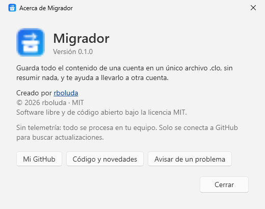
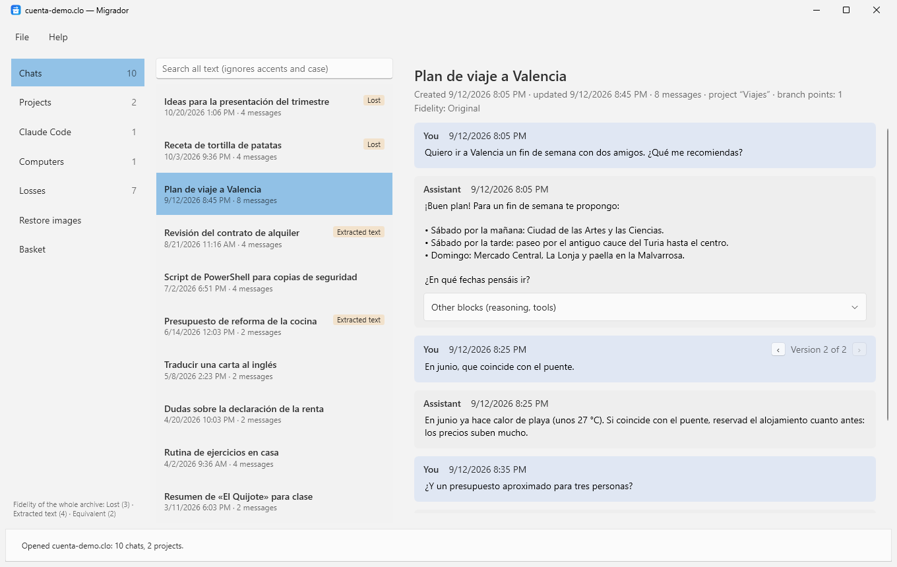

<p align="center">
  
</p>

<h1 align="center">Migrador</h1>

<p align="center">
  Guarda <b>todo</b> el contenido de tu cuenta de claude.ai en un único archivo, sin resumir ni perder nada, y llévalo a otra cuenta.<br>
  Aplicación de escritorio para Windows · Español e inglés · Software libre (MIT)
</p>

<p align="center">
  <a href="https://github.com/rboluda/Claude-migration-suite/releases/latest"><b>Descargar</b></a> ·
  <a href="docs/manual.md">Manual</a> ·
  <a href="CHANGELOG.md">Novedades</a> ·
  <a href="#english">English</a>
</p>


## Para qué sirve

Cuando cambias de cuenta (de Free a Pro o Max, de una cuenta personal a una de Team, o al revés), tus chats, proyectos e instrucciones no viajan contigo. El export de datos los guarda, pero en un formato pensado para máquinas. Migrador lo convierte en un archivo `.clo` que puedes explorar, buscar y conservar, y con el que preparar lo que quieras llevarte.

- **Nada se resume ni se descarta.** Los chats se guardan completos, con todas sus ramas (ediciones y regeneraciones), y el export original se conserva intacto dentro del `.clo`.
- **Sabes qué se ha perdido.** Cada adjunto, imagen y documento tiene un nivel de fidelidad, y la sección *Pérdidas* explica qué era, dónde estaba, qué queda y qué mensajes posteriores dependían de él.
- **También Claude Code.** Copia tu carpeta `.claude` (instrucciones, skills, agentes, historial y memoria de cada proyecto) **sin credenciales ni tokens**.
- **Todo en tu equipo.** Sin telemetría ni servidores. Solo se conecta a GitHub para buscar actualizaciones.

## Capturas

| | |
|---|---|
|  **Pérdidas:** qué falta y a qué afecta |  **Claude Code:** copia sin credenciales |
|  **Búsqueda** sin distinguir tildes ni mayúsculas |  **Proyectos** con instrucciones y documentos |

<p align="center">
   
</p>

## Descarga y uso

1. Descarga `Migrador-x.y.z.exe` de la [última versión](https://github.com/rboluda/Claude-migration-suite/releases/latest) y guárdalo en una carpeta tuya (por ejemplo, `Documentos\Migrador`). Es un único archivo: no hay que instalar nada.
2. Pide el export de tus datos en claude.ai: **Ajustes → Privacidad → Exportar datos**.
3. En Migrador: **Archivo → Importar export…** y después **Guardar como .clo…**

Todo lo demás está en el [manual](docs/manual.md).

> **Estado:** versión 0.1. El lector del export es provisional hasta validarlo con exports reales; *Restaurar imágenes* y la *Cesta* para exportar llegarán en próximas versiones. Ver [limitaciones](docs/manual.md#12-limitaciones-de-esta-versión).

## Privacidad

Todo se procesa en tu equipo. La única conexión que hace Migrador es para las actualizaciones: como mucho una vez al día (o con *Ayuda → Buscar actualizaciones*) consulta la API pública de GitHub (`api.github.com/repos/rboluda/Claude-migration-suite/releases/latest`) y, si hay una versión nueva, descarga el ejecutable y su `SHA256SUMS.txt` desde GitHub. Antes de instalarla comprueba el SHA-256 y que el archivo sea Migrador en esa versión. Estas peticiones no llevan nada tuyo más allá de lo que lleva cualquier petición HTTPS (la IP y un `User-Agent` con la versión). Las dos opciones (buscar e instalar sin preguntar) se pueden desactivar en *Archivo → Ajustes*.

## Compilar

Requiere el SDK de .NET 10.

```
dotnet test tests/Migrador.Tests
dotnet publish src/Migrador.App -c Release -o publish
```

Al subir una etiqueta `vX.Y.Z`, GitHub Actions compila, prueba y publica la Release con el ejecutable y `SHA256SUMS.txt`.

## Autor y licencia

Creado por [rboluda](https://github.com/rboluda). Software libre y de código abierto bajo la [licencia MIT](LICENSE).

---

## English

**Migrador** saves **all** the content of your claude.ai account in a single `.clo` file, without summarizing or losing anything, so you can explore it, keep it and take what you need to another account. Windows desktop app, Spanish and English interface, free and open source (MIT).



- **Nothing is summarized or dropped.** Chats are kept whole with every branch (edits and regenerations), and the original export is stored untouched inside the `.clo`.
- **You know what is missing.** Every attachment, image and document has a fidelity level, and the *Losses* section explains what it was, where, what remains and which later messages depended on it.
- **Claude Code too.** Copies your `.claude` folder (instructions, skills, agents, each project's history and memory) **without credentials or tokens**.
- **Everything stays on your computer.** No telemetry, no servers. It only contacts GitHub to check for updates (at most once a day; downloads are verified by SHA-256; both options can be turned off in *File → Settings*).

**Download** `Migrador-x.y.z.exe` from the [latest release](https://github.com/rboluda/Claude-migration-suite/releases/latest) · [User guide](docs/manual.en.md) · [Changelog](CHANGELOG.md)

Created by [rboluda](https://github.com/rboluda). Free and open-source software under the [MIT license](LICENSE).
