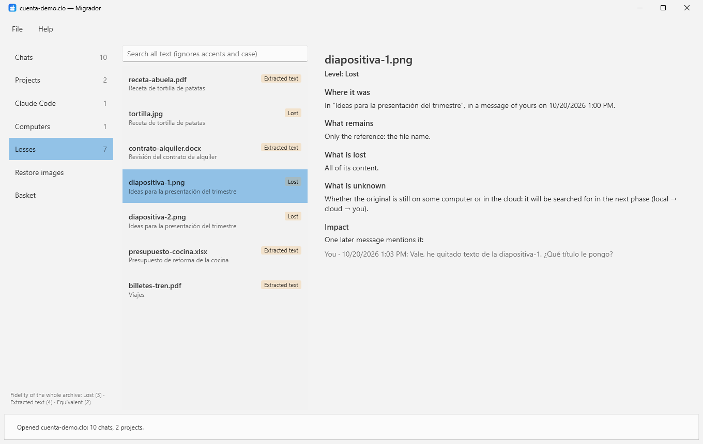

# Migrador user guide

*[Versión en español](manual.md)*

Migrador saves all the content of a claude.ai account in a single `.clo` file, without summarizing or losing anything, and helps you take it to another account. Everything is processed on your computer.

> Version 0.1. The export reader is provisional: it is still being validated against real exports. The *Restore images* and *Basket* sections will come in future versions.

## 1. Installation

Requirements: 64-bit Windows 10 or 11. Nothing else to install: the executable includes .NET.

1. Download `Migrador-x.y.z.exe` from the [latest release](https://github.com/rboluda/Claude-migration-suite/releases/latest).
2. Save it in a folder of yours, for example `Documents\Migrador`. To update itself, the folder must be writable without administrator rights (avoid `Program Files`).
3. Open it. If Windows shows "Windows protected your PC", click **More info → Run anyway** (the executable is not digitally signed yet).

## 2. Getting started

1. **Request your data export.** On claude.ai: **Settings → Privacy → Export data**. You will get an email with a link to a `.zip`. The link expires after a few hours: download it as soon as it arrives.
2. **Import it.** In Migrador: **File → Import export…** (Ctrl+I) and choose the `.zip`. No need to unzip it.
3. **Save it as `.clo`.** **File → Save as .clo…** (Ctrl+S). This file is your copy: it holds the untouched original export and everything Migrador interpreted. It is fully verified when saved.
4. **Optional: add Claude Code.** If you use Claude Code on this computer, **File → Add Claude Code from this computer** copies your `.claude` folder (without credentials). Save the `.clo` again to keep it.

Later, open the `.clo` with **File → Open .clo…** (Ctrl+O).

## 3. The window

- **Left, navigation:** Chats, Projects, Claude Code, Computers, Losses, Restore images and Basket, with the number of items in each. Below, the fidelity of the whole archive.
- **Middle, list:** the items of the chosen section, with the search box on top. A tag on the right shows the item's worst fidelity level when it is not *Original*.
- **Right, reader:** the selected item.

## 4. Chats and branches

A chat is not a list: editing a message or asking for another answer creates a branch. Migrador keeps **every branch**.

- The branch that was active in your account is shown by default.
- Where a message has several versions, **‹ Version 2 of 2 ›** appears. The arrows switch versions and show the conversation that followed each one.
- **Other blocks (reasoning, tools)** expands reasoning and tool calls that are not part of the answer text.
- Attachments appear under their message with their fidelity level.

## 5. Search

Type in the list's search box. It searches titles and the text of every message (and, in Projects, instructions and documents), **ignoring accents and case**.

## 6. Projects

Each project shows its description, **instructions** and knowledge **documents** with their fidelity level.

## 7. Losses and fidelity

| Level | Meaning |
|---|---|
| **Original** | Identical to the original, verified by hash. |
| **Equivalent** | Found by content and may differ in details, or restored and confirmed by you. For text files the export keeps the full text, but it cannot be verified byte by byte. |
| **Extracted text** | Only the text remains: no formatting, formulas or embedded images (typical of PDF, Word or Excel). |
| **Reconstruction** | A description generated afterwards. Always shown as such. |
| **Lost** | Only the file name remains (typical of images: the export does not include them). |

The fidelity of a chat, project or the whole archive is **the worst level plus a count per level**, never an average.

The **Losses** section lists everything that is not original and, for each item, where it was, what remains, what is lost, what is unknown, and its **impact**: the later messages that mention it by name.

## 8. Claude Code

**File → Add Claude Code from this computer** copies `%USERPROFILE%\.claude`: instructions (`CLAUDE.md`), settings, skills, agents, commands, plugins, and each project's session history and memory.

**Not copied:** credentials (`.credentials.json`, `.claude.json`), session tokens (`ide/`), configuration backups (`backups/`) and caches.

> **Warning:** Claude Code deletes old session history on its own (by default, older than 30 days; set with `cleanupPeriodDays` in `settings.json`). Whatever has been deleted cannot be recovered: add your Claude Code to the `.clo` as soon as possible.

## 9. The .clo file

A `.clo` is a ZIP holding a `manifest.json` (with the SHA-256 of every entry), the **untouched original export**, each chat with its full message tree, each project, binary files stored once by hash, each computer's `.claude` copy, and reconstructions kept apart from the original content. Data the reader does not understand is never discarded. Saving writes to a temporary file first, then verifies the whole package.

## 10. Settings and updates

**File → Settings…**: interface language (Spanish or English; the app restarts), **check for updates automatically** (at most once a day) and **install them without asking when Migrador closes**. Every version is checked against its published SHA-256 and product version before it is installed; if anything does not match, nothing is installed.

## 11. Privacy

Everything is processed locally. No telemetry, no servers of our own. The only connection is the update check against the public GitHub API and the download of new versions from GitHub. Nothing of yours is sent.

## 12. Known limitations

- The export reader is provisional and not yet validated against real exports. The original export is always kept in the `.clo`.
- *Restore images*, *Basket* (exporting for the new account), indexed search, restoring Claude Code on another computer and merging several computers are on the way.

---

Migrador is free and open-source software under the [MIT license](../LICENSE). Created by [rboluda](https://github.com/rboluda).
