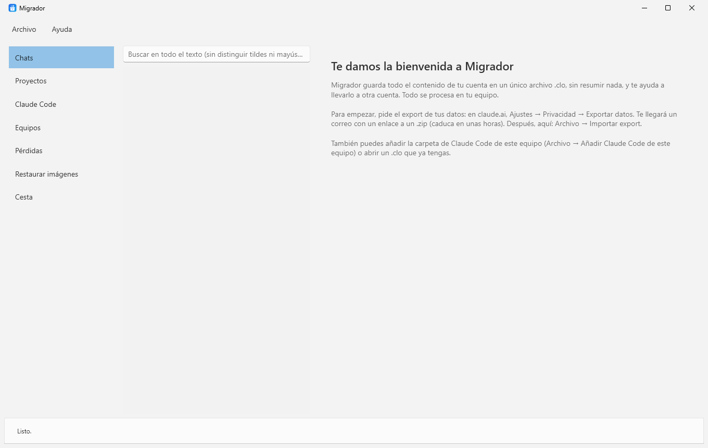
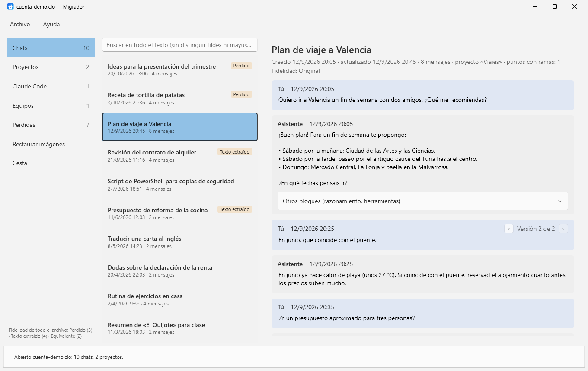
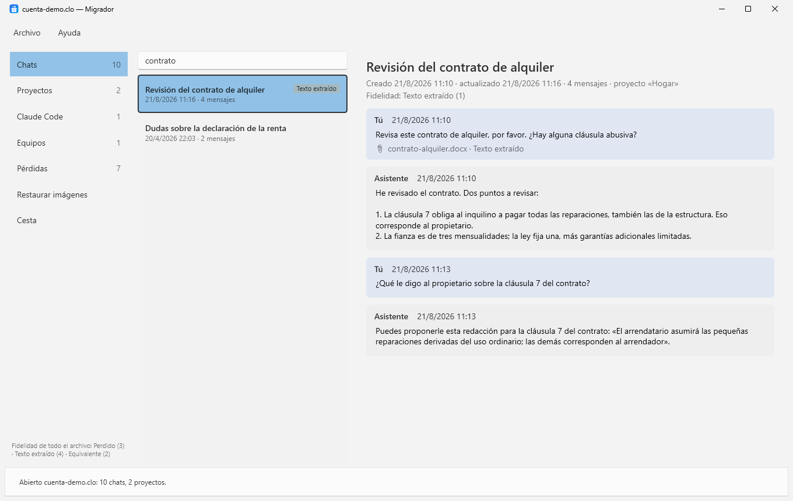
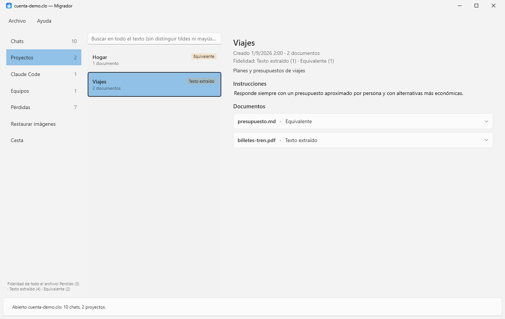
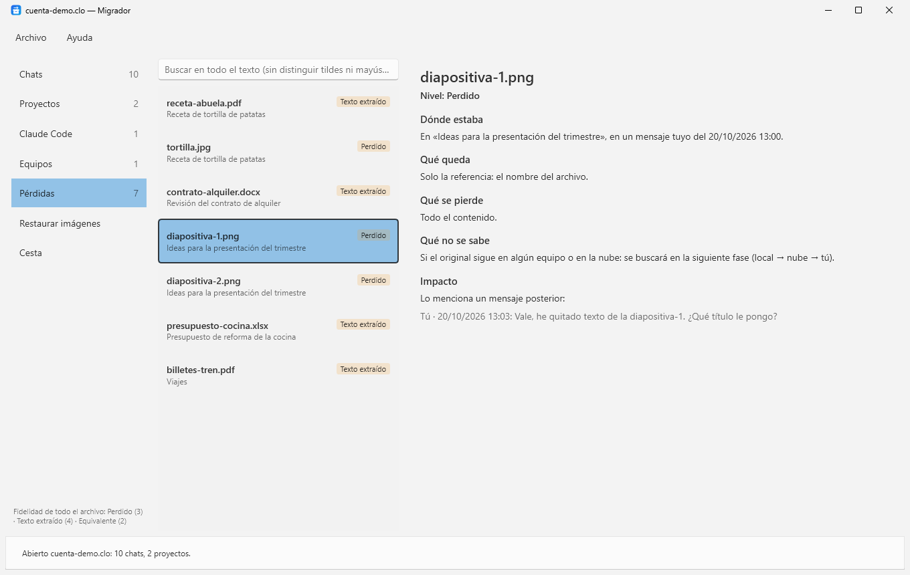
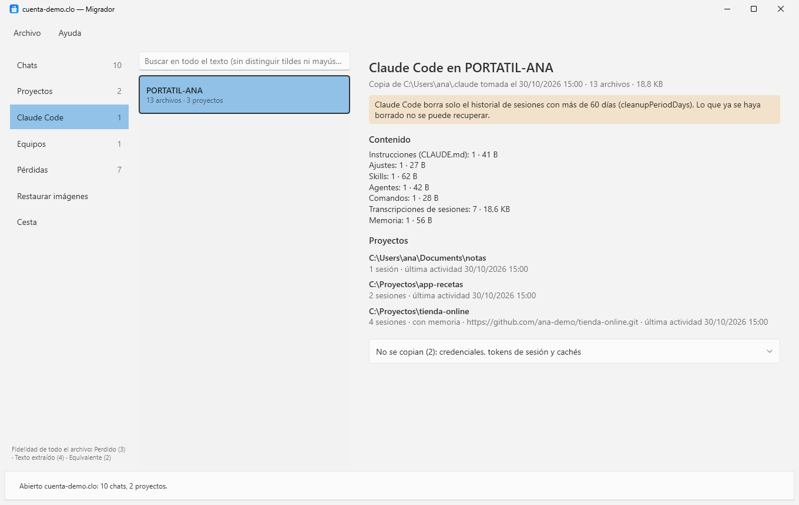
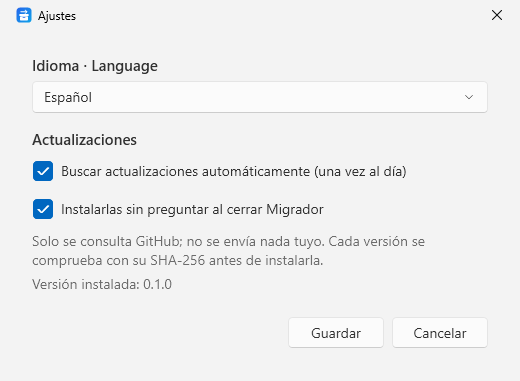

# Manual de Migrador

*[English version](manual.en.md)*

Migrador guarda todo el contenido de una cuenta de claude.ai en un único archivo `.clo`, sin resumir ni perder nada, y te ayuda a llevarlo a otra cuenta. Todo se procesa en tu equipo.

> Versión 0.1. El lector del export es provisional: aún se está validando con exports reales. Las secciones *Restaurar imágenes* y *Cesta* llegarán en próximas versiones.

## Índice

1. [Instalación](#1-instalación)
2. [Primeros pasos](#2-primeros-pasos)
3. [La ventana](#3-la-ventana)
4. [Chats y ramas](#4-chats-y-ramas)
5. [Buscar](#5-buscar)
6. [Proyectos](#6-proyectos)
7. [Pérdidas y fidelidad](#7-pérdidas-y-fidelidad)
8. [Claude Code](#8-claude-code)
9. [El archivo .clo](#9-el-archivo-clo)
10. [Ajustes y actualizaciones](#10-ajustes-y-actualizaciones)
11. [Privacidad](#11-privacidad)
12. [Limitaciones de esta versión](#12-limitaciones-de-esta-versión)
13. [Problemas frecuentes](#13-problemas-frecuentes)

## 1. Instalación

Requisitos: Windows 10 u 11 de 64 bits. No hace falta instalar nada más: el ejecutable incluye .NET.

1. Descarga `Migrador-x.y.z.exe` de la [última versión](https://github.com/rboluda/Claude-migration-suite/releases/latest).
2. Guárdalo en una carpeta tuya, por ejemplo `Documentos\Migrador`. Para que se actualice solo, la carpeta tiene que admitir escritura sin permisos de administrador (evita `Archivos de programa`).
3. Ábrelo. Si Windows muestra «Windows protegió su PC», pulsa **Más información → Ejecutar de todas formas** (el ejecutable aún no está firmado digitalmente).

## 2. Primeros pasos



1. **Pide el export de tus datos.** En claude.ai: **Ajustes → Privacidad → Exportar datos**. Te llegará un correo con un enlace a un `.zip`. El enlace caduca a las pocas horas: descárgalo en cuanto llegue.
2. **Impórtalo.** En Migrador: **Archivo → Importar export…** (Ctrl+I) y elige el `.zip`. No hace falta descomprimirlo.
3. **Guárdalo como `.clo`.** **Archivo → Guardar como .clo…** (Ctrl+S). Este archivo es tu copia: contiene el export original intacto y todo lo que Migrador ha interpretado. Al guardarlo se comprueba entero.
4. **Opcional: añade Claude Code.** Si usas Claude Code en este equipo, **Archivo → Añadir Claude Code de este equipo** copia tu carpeta `.claude` (sin credenciales). Vuelve a guardar el `.clo` para conservarla.

Más adelante, abre el `.clo` con **Archivo → Abrir .clo…** (Ctrl+O). También puedes arrastrarlo sobre `Migrador.exe` o asociar la extensión `.clo` a Migrador.

## 3. La ventana



- **Izquierda, navegación:** Chats, Proyectos, Claude Code, Equipos, Pérdidas, Restaurar imágenes y Cesta, con el número de elementos de cada sección. Debajo, la fidelidad del archivo entero.
- **Centro, lista:** los elementos de la sección elegida, con el buscador arriba. Una etiqueta a la derecha indica el peor nivel de fidelidad del elemento si no es *Original*.
- **Derecha, lector:** el elemento seleccionado.
- **Barra inferior:** lo que está haciendo Migrador y el resultado de la última operación.

Los paneles se pueden ensanchar arrastrando el borde entre ellos.

## 4. Chats y ramas

Un chat no es una lista: cuando editas un mensaje o pides otra respuesta, el chat se bifurca. Migrador conserva **todas las ramas**.

- Por defecto se muestra la rama que estaba activa en tu cuenta.
- Donde hay varias versiones de un mensaje aparece **‹ Versión 2 de 2 ›**. Las flechas cambian de versión y muestran la conversación que siguió a esa versión.
- **Otros bloques (razonamiento, herramientas)** despliega el razonamiento y las llamadas a herramientas que no forman parte del texto de la respuesta.
- Los adjuntos aparecen bajo el mensaje con su nivel de fidelidad (📎 archivos con texto, 🖼 imágenes y archivos solo referenciados).
- Si el export no indica qué mensaje responde a cuál, el lector lo avisa: los mensajes se muestran en orden y las ramas, si existían, no están en los datos.

## 5. Buscar



Escribe en el buscador de la lista. Busca en el título y en el texto de todos los mensajes (en Proyectos, también en las instrucciones y los documentos), **sin distinguir tildes ni mayúsculas**: «revision» encuentra «Revisión».

## 6. Proyectos



Cada proyecto muestra su descripción, sus **instrucciones** y sus **documentos** de conocimiento con su nivel de fidelidad. Despliega un documento para ver su contenido.

## 7. Pérdidas y fidelidad



Migrador nunca da por bueno lo que no puede comprobar. Cada adjunto, imagen o documento tiene un nivel:

| Nivel | Qué significa |
|---|---|
| **Original** | Idéntico al original, comprobado por su huella (hash). |
| **Equivalente** | Encontrado por su contenido y puede diferir en detalles, o restaurado y confirmado por ti. Para archivos de texto (`.txt`, `.md`, código…) el export guarda el texto completo, pero no se puede comprobar byte a byte. |
| **Texto extraído** | Solo queda el texto: sin formato, fórmulas ni imágenes internas (típico de PDF, Word o Excel). |
| **Reconstrucción** | Descripción generada a posteriori. Siempre se muestra como tal. |
| **Perdido** | Solo queda el nombre del archivo (típico de las imágenes: el export no las incluye). |

La fidelidad de un chat, de un proyecto o del archivo entero es **el peor nivel y el recuento de cada nivel**, nunca una media.

La sección **Pérdidas** reúne todo lo que no es original. Para cada elemento indica:

- **Dónde estaba:** el chat y el mensaje.
- **Qué queda** y **qué se pierde.**
- **Qué no se sabe:** por ejemplo, si el original sigue en algún equipo.
- **Impacto:** los mensajes posteriores que lo mencionan por su nombre. Así sabes qué partes de la conversación dependían de él.

## 8. Claude Code



**Archivo → Añadir Claude Code de este equipo** copia la carpeta `%USERPROFILE%\.claude`:

- Instrucciones (`CLAUDE.md`), ajustes, skills, agentes, comandos y plugins.
- El historial de sesiones de cada proyecto y su memoria.

**No se copian** las credenciales (`.credentials.json`, `.claude.json`), los tokens de sesión (`ide/`), las copias de seguridad de la configuración (`backups/`) ni las cachés. La lista exacta aparece desplegando «No se copian».

De cada proyecto se muestra su carpeta real, el número de sesiones, si tiene memoria y, si es un repositorio git, su remoto. El remoto es lo que permitirá reconocer el mismo proyecto en otro equipo.

> **Aviso:** Claude Code borra solo el historial de sesiones antiguo (por defecto, el de más de 30 días; se cambia con `cleanupPeriodDays` en `settings.json`). Lo que ya se haya borrado no se puede recuperar: añade tu Claude Code al `.clo` cuanto antes.

## 9. El archivo .clo

Un `.clo` es un ZIP con esta estructura:

```
manifest.json               Contenido del paquete y huella SHA-256 de cada archivo
original/export.zip         El export de la cuenta, tal cual, sin tocar
chats/<id>.json             Cada chat con su árbol de mensajes completo
projects/<id>.json          Cada proyecto con sus instrucciones y documentos
blobs/<sha256>.<ext>        Archivos binarios, guardados una sola vez
claude-code/<equipo>/...    Copia de la carpeta .claude de cada equipo
reconstructions/<id>.md     Descripciones generadas a posteriori, separadas del original
```

- El **export original** se guarda siempre intacto. Si una versión futura de Migrador lo interpreta mejor, puede volver a leerlo.
- Lo que el lector no entiende **no se descarta**: los campos desconocidos se conservan tal cual y el resto sigue dentro del export original.
- Al guardar, Migrador escribe primero en un archivo temporal y solo después sustituye el anterior: un corte no deja un `.clo` a medias. Después comprueba la huella de cada archivo del paquete.

## 10. Ajustes y actualizaciones



**Archivo → Ajustes…**

- **Idioma:** español o inglés. Por defecto, el de Windows. Al cambiarlo, Migrador se reinicia.
- **Buscar actualizaciones automáticamente:** como mucho una vez al día. También a mano con **Ayuda → Buscar actualizaciones**.
- **Instalarlas sin preguntar al cerrar Migrador:** la versión nueva se descarga en segundo plano y se instala al cerrar la aplicación. Si aparece el aviso azul de versión lista, **Reiniciar ahora** la aplica al momento. Nunca interrumpe una operación en curso.

Antes de instalar una versión, Migrador comprueba su huella SHA-256 con la publicada en GitHub y que el archivo sea Migrador en esa versión. Si algo no cuadra, no instala nada.

## 11. Privacidad

- Todo se procesa en tu equipo. Sin telemetría ni servidores propios.
- La única conexión es la de las actualizaciones: consulta la API pública de GitHub y, si hay versión nueva, descarga el ejecutable desde GitHub. No se envía nada tuyo, solo lo que lleva cualquier petición HTTPS (la IP y la versión de Migrador).
- El `.clo` contiene tus conversaciones: guárdalo en un lugar seguro.

## 12. Limitaciones de esta versión

- **Lector del export provisional:** se basa en el formato conocido del export y aún no se ha validado con exports reales. Si al importar aparecen avisos en la barra inferior, el `.clo` conserva igualmente el export original.
- **Restaurar imágenes** (buscar en tus equipos las imágenes que el export solo referencia) y **Cesta** (exportar chats y proyectos para la cuenta nueva) llegarán en próximas versiones.
- La búsqueda es básica: con miles de chats puede tardar algo más. La búsqueda indexada llegará más adelante.
- Restaurar Claude Code en otro equipo y juntar los datos de varios equipos también están en camino.

## 13. Problemas frecuentes

**Windows no deja abrir el ejecutable.** Pulsa *Más información → Ejecutar de todas formas*. Es el aviso habitual para programas sin firma digital.

**No se actualiza solo.** Comprueba que el ejecutable está en una carpeta donde puedas escribir sin ser administrador, que se llama `Migrador.exe` y que las actualizaciones están activadas en Ajustes. Si no, Migrador te avisa de la versión nueva y la puedes descargar a mano.

**Al importar aparecen avisos.** El export contiene algo que esta versión aún no interpreta. No se pierde nada: está dentro del export original guardado en el `.clo`. Avísanos con **Ayuda → Acerca de → Avisar de un problema**, sin adjuntar tus datos.

**«El archivo guardado no supera la comprobación».** El disco o la carpeta de destino ha dado un error al escribir. Guarda en otra carpeta o en otro disco.

---

Migrador es software libre y de código abierto bajo la [licencia MIT](../LICENSE). Creado por [rboluda](https://github.com/rboluda).
